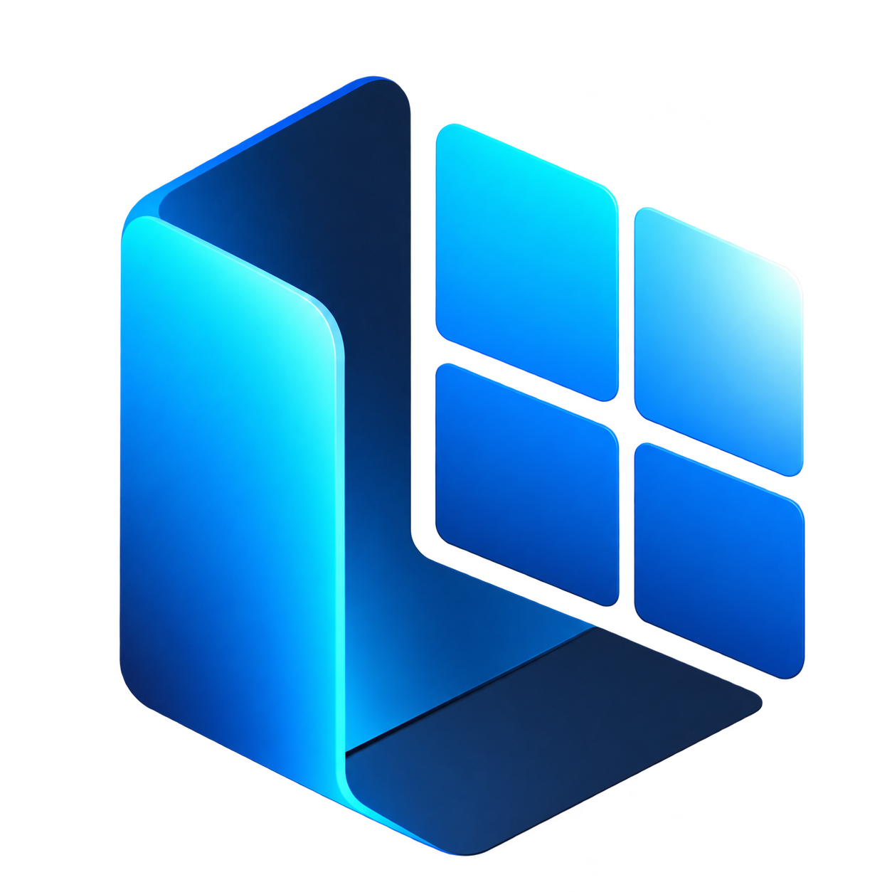
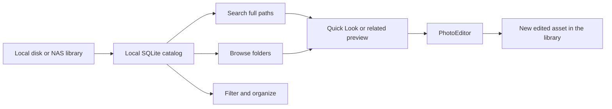

<div align="center">
  

# LumiaDAM

**Find the right 3D asset without reorganizing your archive.**

A local-first digital asset manager for large 3D, CAD, architecture, material, texture, and reference libraries on Windows, local disks, and NAS storage.

[](https://github.com/yuxelmurat/LumiaDAM)
[](https://github.com/yuxelmurat/LumiaDAM/actions/workflows/ci.yml)
[](LICENSE)
[](https://tauri.app/)
[](https://www.rust-lang.org/)
[](https://react.dev/)

[Features](#what-lumiadam-does) · [Workflow](#from-archive-to-edit) · [Build](#build-from-source) · [Roadmap](#roadmap) · [Support](#support-lumiadam)
</div>

---

## Your archive already has structure. LumiaDAM makes it searchable.

Production libraries rarely arrive with clean metadata. They arrive as years of nested folders, purchased model packs, renderer variants, ZIP archives, numeric filenames, and preview renders:

```text
A:/Model Archive/2025/Living Room/3dsky/Corona/2542154.zip
A:/Model Archive/2025/Living Room/3dsky/Corona/2542154.jpg
```

LumiaDAM indexes that structure into a local SQLite catalog. A search for `living corona` can find the asset through its full path even when the file itself is named `2542154.zip`. Browsing and filtering query the catalog instead of repeatedly walking the NAS.

## What LumiaDAM does

|     | Capability                      | What it means in practice                                                                                                                                                   |
| --- | ------------------------------- | --------------------------------------------------------------------------------------------------------------------------------------------------------------------------- |
| 🔎  | **Path-aware search**           | Search filenames, tags, and every folder segment. Multiple words can match different parts of the path.                                                                     |
| 📁  | **Browsable folder results**    | Files and folders have separate tabs and counts. Open a matching folder, move up one level, or return to the previous result set.                                           |
| ⚡  | **Local library catalogs**      | Databases and generated previews live under LumiaDAM's local data directory or a storage location you choose, keeping catalog writes away from the source NAS.              |
| 🧭  | **All Libraries by default**    | Newly added drives and folders use their real root name and appear immediately in the combined library view.                                                                |
| 🖼️  | **Visual previews**             | Standard images plus native HDR and EXR thumbnails. Supported 3D/CAD files can use embedded previews or the optional preview worker when available.                         |
| 🔗  | **Related image matching**      | A model or archive can display a smaller sibling image such as `9.jpg` beside `9.zip`. Matching stays inside the same folder and avoids shared legacy thumbnail collisions. |
| ✨  | **Built-in PhotoEditor**        | Open supported images in the bundled PhotoCraft editor without sending them to a web service. Exports become new cataloged assets beside the source file.                   |
| 🏷️  | **Library organization**        | Tags, ratings, color labels, favorites, and nested collections help add structure without renaming source files.                                                            |
| 👁️  | **Quick Look**                  | Hold `Space` for a larger preview and use `Ctrl+C` to copy the selected asset path.                                                                                         |
| 📊  | **Visible background activity** | The status panel reports scan and preview progress, the last scan time, completed/remaining work, and a rescan action.                                                      |

### Catalog every file, preview what LumiaDAM understands

LumiaDAM does not hide an asset because its format has no thumbnail. Regular files, unknown extensions, extensionless files, and archives are cataloged and remain searchable. ZIP contents are not extracted or indexed automatically.

Preview support varies by format:

- **Images:** JPG/JPEG, PNG, WebP, BMP, TIFF, GIF, TGA, HDR, and EXR.
- **Editable in PhotoEditor:** JPG/JPEG, PNG, WebP, BMP, TIFF, and layered `.pcraft` projects.
- **3D/CAD and design files:** formats such as MAX, RVT/RFA, DWG/DXF, SKP, BLEND, C4D, 3DM, OBJ, FBX, GLTF/GLB, STL, materials, and IES files are indexed. Preview availability depends on embedded data and installed preview tooling.

Indexing a format does not imply full geometry parsing, renderer compatibility detection, or one-click import into a DCC application.

## From archive to edit



1. Add a drive or root folder as a library.
2. LumiaDAM catalogs its files and builds previews while reporting progress.
3. Search by filename, folder, year, room, vendor, or renderer name.
4. Browse the matching folder or refine the result with type and metadata filters.
5. Open an image in **PhotoEditor**, export a new version, and keep the original untouched.

The application menu beside the LumiaDAM logo keeps **Libraries**, **PhotoEditor**, and **Settings** in one consistent place. Switching back to Libraries does not discard the current editor session.

## Storage designed for real archives

By default, LumiaDAM stores its catalogs and thumbnails under:

```text
%LOCALAPPDATA%/LumiaDAM/
  data/                              # app settings and library list
  libraries/
    Library_Name--<unique-id>/
      library.sqlite
      thumbs/
```

The source library remains free of new database and thumbnail folders. You can choose another catalog location in **Settings**, with a clear warning that a slow disk or network destination will also slow search and preview access. Existing catalogs continue to work when the NAS is offline; opening source files and generating missing previews still require the source to be reachable.

[Read the storage and migration guide](docs/storage.md) · [Read the folder search guide](docs/folder-search.md)

## PhotoEditor

LumiaDAM packages a pinned build of [PhotoCraft](https://github.com/storytold/photocraft) as a local web editor inside the desktop application.

- Images stay on the computer; the editor does not upload them to a hosted service.
- Export writes a new `source_edited_<id>` file beside the original.
- The new file is inserted into the catalog and queued for thumbnail generation without rescanning the entire library.
- The original file is never overwritten by the LumiaDAM export bridge.
- Failed saves remain visible and can be retried without sending duplicate exports.

The integration currently supports one editor session and a 256 MB source/output limit. HDR, EXR, PSD, and HEIF editing are outside the verified editor scope even when LumiaDAM can preview some of those formats.

[PhotoEditor usage, limits, and upstream update process](docs/PHOTOCRAFT.md)

## Project status

LumiaDAM is in active **v0.1.0 development**. The current codebase contains the Windows application, local catalog architecture, path-aware folder search, background status reporting, related previews, HDR/EXR thumbnails, and embedded PhotoEditor integration.

There is no public signed installer release yet. The Releases page will become the download source after the first tested package is published. Until then, build LumiaDAM from source and evaluate it with backed-up sample libraries.

## Build from source

### Requirements

- Windows 10 or 11
- Node.js 20+
- pnpm 9+
- Rust stable with the MSVC toolchain
- Visual Studio C++ Build Tools and Windows SDK
- WebView2 Runtime
- `wasm32-unknown-unknown` Rust target and Trunk 0.21.14 for PhotoEditor
- Python 3.10+ and optional preview dependencies for the Python preview worker

### Development

```powershell
git clone https://github.com/yuxelmurat/LumiaDAM.git
cd LumiaDAM

pnpm install --frozen-lockfile
rustup target add wasm32-unknown-unknown
cargo install trunk --version 0.21.14 --locked

pnpm dev
```

### Checks and Windows package

```powershell
pnpm --filter @lumiadam/desktop typecheck
pnpm --filter @lumiadam/desktop test
pnpm --filter @lumiadam/desktop vite:build
pnpm build
```

Build artifacts are written under:

```text
apps/desktop/src-tauri/target/release/lumiadam-desktop.exe
apps/desktop/src-tauri/target/release/bundle/
```

The NSIS installer target is configured, but clean-computer installer validation is still part of the roadmap.

See [CONTRIBUTING.md](CONTRIBUTING.md) for the repository layout and development workflow.

## Roadmap

### Available now

- [x] LumiaDAM application identity, Windows icons, installer naming, and navigation
- [x] Local catalog and preview storage with configurable location
- [x] Multi-library search backed by SQLite
- [x] Full-path search and browsable folder results
- [x] Separate Files and Folders views with counts
- [x] Scan/preview activity panel and manual rescan
- [x] Same-folder related preview matching
- [x] Native HDR and EXR thumbnail generation
- [x] Embedded local PhotoEditor with safe, non-destructive exports

### Planned

- [ ] Clean-computer installer validation and a public signed release
- [ ] 3ds Max bridge for sending renders directly into a library
- [ ] PhotoEditor handoff from DCC render workflows
- [ ] Broader preview coverage and packaged Python preview dependencies
- [ ] NAS/SMB performance benchmarks and multi-machine catalog strategy
- [ ] Safer file operations and recovery-focused deletion behavior

Features in the planned list are not implemented promises or release commitments.

## Support LumiaDAM

LumiaDAM is free and open source. If the project saves time in your asset workflow, you can support its continued development:

<a href="https://buymeacoffee.com/yuxelmurat8"></a>

You can also help by testing with real-world libraries, documenting reproducible bugs, or contributing focused pull requests.

## License and credits

LumiaDAM is distributed under the [MIT License](LICENSE). The original copyright notice for OpenDAM Contributors remains in the license as required.

LumiaDAM began from the MIT-licensed [OpenDAM](https://github.com/LawLaw09/OpenDAM) codebase and has since introduced its own product identity, local catalog storage model, archive-focused search and folder navigation, preview behavior, status interface, and PhotoEditor workflow.

The embedded image editor is based on [PhotoCraft](https://github.com/storytold/photocraft), licensed under MIT OR Apache-2.0. Its license and attribution files are preserved in packaged builds.

---

<div align="center">
  Built for artists, archivists, and studios whose folders are already the database.
</div>
