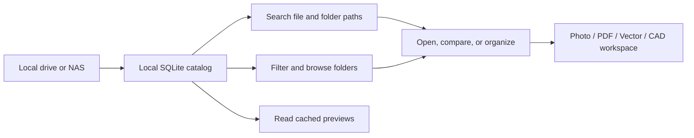

<div align="center">
  

# LumiaDAM

### Find the right asset in the archive you already have.

**A local-first digital asset manager for 3D models, textures, HDRI, EXR, CAD drawings, and interior design libraries.**

Search nested folders across Windows drives and NAS storage, preview assets, organize collections, and continue into image, PDF, vector, and CAD workflows—all from one desktop library.

[](https://github.com/yuxelmurat/LumiaDAM/releases)
[](https://github.com/yuxelmurat/LumiaDAM/releases)
[](LICENSE)
[](https://tauri.app/)
[](https://www.rust-lang.org/)
[](https://react.dev/)

[Download for Windows](https://github.com/yuxelmurat/LumiaDAM/releases) · [Features](#what-you-can-do) · [Development status](#availability-and-development-status) · [Build from source](#build-from-source) · [Support](#support-lumiadam)

<sub>Türkçe: LumiaDAM; 3D model, texture, HDRI/EXR, CAD ve iç mimari arşivlerini yerel disklerde veya NAS üzerinde kataloglayıp tam klasör yolunda arayan Windows uygulamasıdır. Görsel, PDF, vektör ve CAD iş akışlarını tek yerde toplar.</sub>
</div>

---

## Your archive already has structure. Make it searchable.

Real production libraries are built over years: purchased model packs, renderer-specific folders, render previews, numeric filenames, and inconsistent naming. LumiaDAM searches that structure instead of asking you to reorganize it.

```text
A:/Model Archive/2025/Living Room/3dsky/Corona/2542154.zip
A:/Model Archive/2025/Living Room/3dsky/Corona/2542154.jpg
```

Search for `living corona` and find an asset through its folder path even when its filename is only a number. LumiaDAM catalogs file and folder metadata in a local SQLite database, so filters query the catalog instead of repeatedly searching a NAS from scratch.

## What you can do

| Capability | How it helps |
| --- | --- |
| **Search by full path** | Match filenames and folder names together. Find `kitchen` in a deeply nested path such as year / vendor / room / renderer even when the model is called `2542154.zip`. |
| **Browse the library tree** | Expand library folders in the sidebar, open folder search results, and move through the archive. Separate **Files** and **Folders** tabs show item counts. |
| **Filter large asset libraries** | Narrow results by file type, 3D software, year, source, room, renderer, rating, color label, favorite, tag, or availability. |
| **Keep the source archive intact** | Catalogs and generated thumbnails are stored locally or in a location you choose—not inside the source library. Cached previews can remain available while a NAS is offline. |
| **Preview assets locally** | Browse image previews, including HDR and EXR tone-mapped previews where supported. Files without a preview remain searchable and can open in their Windows default application. |
| **Pair render previews with models** | Show a likely sibling render such as `9.jpg` beside `9.zip`. Matching is constrained to the same folder to avoid unrelated thumbnails from elsewhere in the archive. |
| **Organize without renaming files** | Use favorites, ratings, color labels, tags, nested collections, and smart filters while preserving original filenames and folders. |
| **Review a project** | Compare selected assets and gather work in the Project Board with project-scoped notes. |
| **See background work** | The activity panel reports scanning and preview progress, remaining work, failures, last scan time, and a rescan action. |
| **Open files the way Windows expects** | Double-click or use the context menu to open a file in its associated desktop application. Use built-in workspaces for supported image, PDF, vector, and CAD files. |

### Formats and previews

LumiaDAM catalogs files even when it cannot render a preview. Preview and editing support depend on file encoding, installed Windows providers, and the selected editor; indexing a format does not mean LumiaDAM fully parses or edits it.

- **Images and environments:** JPG/JPEG, PNG, WebP, BMP, TIFF, GIF, TGA, HDR, and EXR. HDR/EXR preview availability depends on the decoder or Windows thumbnail provider available on the PC.
- **3D and design libraries:** MAX, BLEND, C4D, 3DM, OBJ, FBX, GLTF/GLB, STL, SKP, RVT/RFA, materials, IES, and common archive formats are cataloged. Thumbnail availability varies.
- **CAD drawings:** DWG and DXF can be opened in the local CAD Viewer. Newer DWG versions, custom/proxy entities, and external references may be incomplete.
- **Archives:** ZIP and other supported archive files are cataloged as files. LumiaDAM does not silently unpack and index every archive as part of normal library scanning.

## Built-in creative workspaces

The editor workspaces are bundled locally. Files are processed on the computer; LumiaDAM does not upload them to a hosted editing service.

### PhotoEditor — image editing

PhotoEditor packages a pinned local build of [PhotoCraft](https://github.com/storytold/photocraft). Open supported images from the library, edit in a full workspace, and export a new cataloged file beside the original. The LumiaDAM save bridge does not overwrite the source image. HDR, EXR, PSD, HEIF, and other formats outside the verified editor scope may still be preview-only or unsupported.

### PDFEditor — PDF work

PDFEditor packages [PdfCraft](https://github.com/storytold/pdfcraft) for opening PDFs in the app. Its current workspace supports PDF-focused tasks such as reading, annotation, forms, and page organization. Saves create a new cataloged PDF. This is an actively developed integration, not a claim of complete Acrobat parity.

### VectorEditor — vector graphics

VectorEditor packages [VectorCraft](https://github.com/storytold/vectorcraft). It supports SVG/SVGZ, VectorCraft projects, PDF-compatible AI files, PDFs, and supported bitmap images. Import/export coverage varies; it is not a promise of full Illustrator compatibility.

### CAD Viewer and CADCraft — technical drawings

The local CAD Viewer is based on the MIT-licensed [Exav Viewer](https://github.com/sylvinus/exav). It opens DWG and DXF drawings for quick inspection, with pan, zoom, fit-to-view, layouts, and layer visibility. Files stay on the computer; interactive viewing still needs the source file to be reachable.

**CADCraft editing is experimental.** Some drawing entities or advanced DWG features may not round-trip correctly. Keep a backup of important drawings and verify saved files in your CAD application.

## 3ds Max workflow — experimental

The optional LumiaDAM 3ds Max plugin is designed to send compatible library models or archives into an open Max scene and gather available project files and references in the scene's asset folder. It can report missing renderers, plugins, or dependencies; optional V-Ray-to-Corona conversion depends on a compatible installed Corona Converter and user approval.

Merge results vary with 3ds Max version, archive contents, file references, renderer, and installed plugins. Missing textures or unsupported materials can leave a scene incomplete. This integration is under active development: inspect the merge result and dependencies before rendering. The scene is not saved automatically, and source library files are preserved.

## Optional local AI organizer — experimental

LumiaDAM's local AI workflow is optional and designed to stay idle until the user chooses when it may run. It can review local catalog information and cached previews, then suggest categories and collection groupings for a person to review. The user does not write prompts, and suggestions do not silently move or delete source files.

The model can run through a supported local provider such as Ollama or LM Studio. Model availability, speed, memory use, and visual analysis depend on the user's installation and hardware. Cloud image upload is not part of this workflow. AI organization is experimental; review recommendations before accepting them.

Exact duplicate checks and visually similar preview suggestions are separate concepts: identical-content checks compare file content, while visual matches are candidates for human review. A similar-looking image is not proof that two source files are duplicates.

## How the library stays responsive



LumiaDAM separates the source files from its searchable catalog and preview cache. A disconnected NAS can prevent opening the original file or generating a missing preview, but it does not require deleting the local catalog. Choose the catalog location in Settings; slower network storage for the catalog can make browsing slower.

By default, local data is stored under `%LOCALAPPDATA%/LumiaDAM/`:

```text
data/                         # settings and library list
libraries/<name>--<id>/
  library.sqlite
  thumbs/
```

See the [storage and migration guide](docs/storage.md), [offline preview notes](docs/offline-previews.md), and [folder search guide](docs/folder-search.md).

## Availability and development status

LumiaDAM is open source and under active development. **The latest public release is v0.1.0, a Windows x64 portable build.** It predates some capabilities described on this page. Experimental integrations and features still in development may not be present in that download. Check the [Releases page](https://github.com/yuxelmurat/LumiaDAM/releases) for the exact files available; an installable NSIS package is not currently published there.

The project evolves in reviewable steps. The local AI organizer, CADCraft editing, and 3ds Max merge workflow are explicitly experimental. Renderer/plugin conversion, full DWG editing fidelity, and broad compatibility with every file format are not guaranteed.

## Download and run

1. Open [LumiaDAM Releases](https://github.com/yuxelmurat/LumiaDAM/releases).
2. Download `LumiaDAM_0.1.0_x64-portable.exe` from release `v0.1.0`.
3. Run the portable application on Windows 10/11.

This is the currently published portable build, not a setup installer. Back up valuable libraries before evaluating any in-development file operation.

## Build from source

### Requirements

- Windows 10 or 11
- Node.js 20+ and pnpm 9+
- Rust stable with the MSVC toolchain
- Visual Studio C++ Build Tools and Windows SDK
- WebView2 Runtime
- Optional preview tooling or editor-specific dependencies for some formats

### Development commands

```powershell
git clone https://github.com/yuxelmurat/LumiaDAM.git
cd LumiaDAM
pnpm install --frozen-lockfile
pnpm dev
```

Run the checks relevant to the changed package:

```powershell
pnpm --filter @lumiadam/desktop typecheck
pnpm --filter @lumiadam/desktop test
pnpm --filter @lumiadam/desktop vite:build
pnpm build
```

Windows bundle output is written under `apps/desktop/src-tauri/target/release/bundle/`. Read [CONTRIBUTING.md](CONTRIBUTING.md) for the repository layout and development workflow.

## Search terms

LumiaDAM is a **3D asset manager**, **3D model library manager**, and **digital asset management (DAM) app for Windows**. It is built for **interior designers, architects, 3D artists, visualization studios, and asset librarians** who need to search **3D models, textures, materials, HDRI, EXR, CAD, DWG, DXF, render previews, and architecture libraries** across **nested folders, local drives, external disks, and NAS**. It includes local-first cataloging, a 3ds Max asset workflow, and PhotoEditor, PDFEditor, VectorEditor, and CAD workspaces.

## Support LumiaDAM

LumiaDAM is free and open source. If it helps your workflow, you can support development:

<a href="https://buymeacoffee.com/yuxelmurat8"></a>

You can also help by testing with real libraries, reporting reproducible issues, or contributing focused pull requests.

## License and credits

LumiaDAM is distributed under the [MIT License](LICENSE). The original OpenDAM copyright and attribution notice is preserved in the license.

LumiaDAM began from the MIT-licensed [OpenDAM](https://github.com/LawLaw09/OpenDAM) codebase and has developed a distinct product identity, local catalog and storage model, archive-focused search, folder navigation, preview cache, and creative workflow.

- [PhotoCraft](https://github.com/storytold/photocraft) — image editor; MIT OR Apache-2.0.
- [PdfCraft](https://github.com/storytold/pdfcraft) — PDF editor.
- [VectorCraft](https://github.com/storytold/vectorcraft) — vector editor.
- [Exav Viewer](https://github.com/sylvinus/exav) — MIT-licensed DWG/DXF viewer and embedded drawing preview support.

Third-party components remain subject to their respective licenses. LumiaDAM pins upstream editor builds so updates can be reviewed and tested before adoption.

---

<div align="center">
  Built for artists, archivists, and studios whose folders are already the database.
</div>

